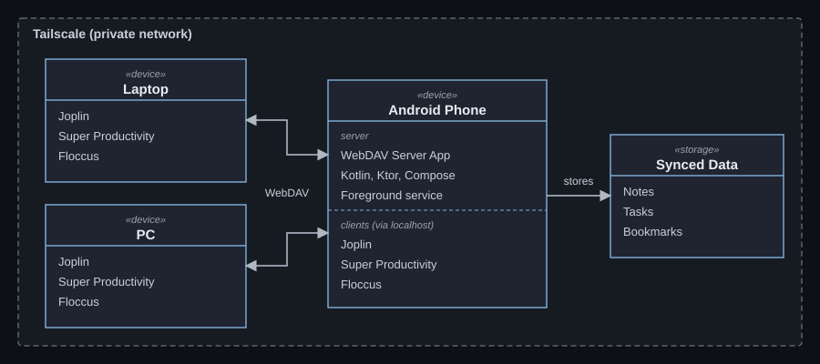

# 👋 WHOAMI — Anuj Kumar Prasad

**Aspiring DevOps / DevSecOps / MLOps Engineer** ⚙️🛡️🤖

🌐 [anujkp.dev](https://anujkp.dev) · 🐙 [GitHub](https://github.com/anujkumarprasad)

_Last updated: 8 Nov 2026_

---

## 🧑‍💻 About me
- 🎓 20 y/o **BCA** student at **MAKAUT** (2025–2029), now in **Sem 3**
- 📍 West Bengal, India 🇮🇳
- 🔨 I learn by **building projects** and self-study
- 🎯 Goal: **DevOps Engineer**, currently seeking an **internship**

## 🛠️ Tech stack

  

| Area | Tools |
|---|---|
| 🐧 OS & Shell | Linux, Windows, Bash |
| 💻 Languages | Python, Kotlin, TypeScript, C (basic) |
| 🌐 Web / Backend | React, Tailwind, Bun, Elysia, Ktor, REST, SQLite |
| ☁️ Cloud & AI | OCI, Generative AI, Prompt Engineering, LLM APIs |

  
  

---

## 🚀 Projects
| # | Project | Stack | Highlight |
|---|---|---|---|
| 1 | 📱 [**WebDAV Server for Android**](https://github.com/anujkumarprasad/webdav-server-apk) | Kotlin, Compose, Ktor | Phone → private WebDAV sync server · 🏅 **HACKHAZARDS '26 top 4%** |
| 2 | ✅ **Nebula Task Manager** | React 19, TS, Bun, Elysia, SQLite | Local-first sync + Groq AI prioritising · 🥈 **Prabuddha 2026** |
| 3 | 🔬 **Just For Science Website** | HTML/CSS, SEO | Local-SEO site on Cloudflare Pages |

## 🏆 Achievements
| 🏅 | Event | Result |
|---|---|---|
| 🥇 | HACKHAZARDS '26 | Top 4% (rank 50–100) of 2,600+ projects |
| 🥈 | Prabuddha 2026 | Second place (Dev Vibe) |
| 🇮🇳 | Smart India Hackathon | Cleared internal round |

## 📜 Certifications
| 🎓 Certificate | Issuer | Date |
|---|---|---|
| OCI 2025 Generative AI Professional | Oracle | 31 Oct 2025 |
| OCI 2025 AI Foundations Associate | Oracle | 26 Oct 2025 |
| AI Prompting for Everyone | DeepLearning.AI | 26 Jul 2026 |
| AI and Public Health | DeepLearning.AI | 31 Jul 2026 |

---

## 🏠 Self-hosted stack
My **own Android WebDAV server app** is the heart of the setup. **3 devices** (phone, laptop, PC) run the sync clients, and **Tailscale** lets me reach everything from anywhere. 🔒

  <picture>
    <source media="(prefers-color-scheme: dark)" srcset="assets/selfhosted.svg" />
    
  </picture>

| 🧩 Service | 🔧 Tool | 💻 Runs on | 🔄 Syncs via |
|---|---|---|---|
| 📝 Notes | Joplin | Phone · Laptop · PC | WebDAV (my app) |
| ✅ Tasks | Super Productivity | Phone · Laptop · PC | WebDAV (my app) |
| 🔖 Bookmarks | Floccus | Phone · Laptop · PC browsers | WebDAV (my app) |
| 🌐 Remote access | Tailscale | All devices | Private mesh VPN |

## 📚 Learning roadmap
| Stage | Topic | Progress |
|---|---|---|
| Now (Sem 3) | 🐍 Python, NumPy, Pandas, Matplotlib | ▰▰▰▰▰▱▱▱ |
| Now (Sem 3) | 🗄️ SQL, MongoDB | ▰▰▱▱▱▱▱▱ |
| Next | 🐧 Deep Linux | ▰▰▰▱▱▱▱▱ |
| Next | 🐳 Docker | ▰▱▱▱▱▱▱▱ |
| Later | 🔁 CI/CD · ☸️ Kubernetes | ▱▱▱▱▱▱▱▱ |
| Later | 🛡️ DevSecOps · 🤖 MLOps | ▱▱▱▱▱▱▱▱ |

## ✨ Style
> Practical builder 🔨 · Self-learner 📖 · Loves self-hosting & automation 🏠
> No LeetCode grind. I prefer **KodeKloud, KillerCoda** and real projects.

---

⭐ Open to internships — say hi at <a href="https://anujkp.dev">anujkp.dev</a> ⭐

